 
 

 
 

<h2 align="center">📊 GitHub Activity</h2>

 

 
 

<h2 align="center">👋 About Me</h2>

 

<table>
<tr>
<td valign="top"></td>
<td valign="top"></td>
</tr>
</table>

 
 

<h2 align="center">🛠️ Tech Stack</h2>

 

 

<h2 align="center">🚀 Featured Projects</h2>

 

<table>
<tr>
<td align="left" valign="top" width="50%">
<b><a href="https://github.com/krishkantrai27/StackForge">StackForge</a></b> 
Vector database built from scratch in Java with zero dependencies. HNSW, KD-Tree and Brute-Force search side by side, plus a local RAG pipeline (Ollama) and live PCA visualization. 
<code>Java · HNSW · RAG · Ollama</code>
</td>
<td align="left" valign="top" width="50%">
<b><a href="https://github.com/krishkantrai27/ProbeLink">ProbeLink</a></b> 
ISP network planning and site survey tool for MDUs, commercial buildings and campuses. Built during the Infosys Springboard internship. 
<code>Spring Boot · React · MySQL · JWT</code>
</td>
</tr>
<tr>
<td align="left" valign="top" width="50%">
<b><a href="https://github.com/krishkantrai27/FarmXchange">FarmXchange</a></b> 
Blockchain-powered agricultural supply chain platform connecting farmers directly with buyers, with on-chain crop traceability. 
<code>Spring Boot · React · MySQL · Solidity</code>
</td>
<td align="left" valign="top" width="50%">
<b><a href="https://github.com/krishkantrai27/blog-application">Blog Application</a></b> 
Full-stack blogging platform with JWT authentication, rich media posts and interactive comments. 
<code>Spring Boot · React · JWT</code>
</td>
</tr>
</table>

 

<h2 align="center">🤝 Let's Connect</h2>

<b>Full Stack Java Developer · Backend Engineer · AI Builder</b>

 

