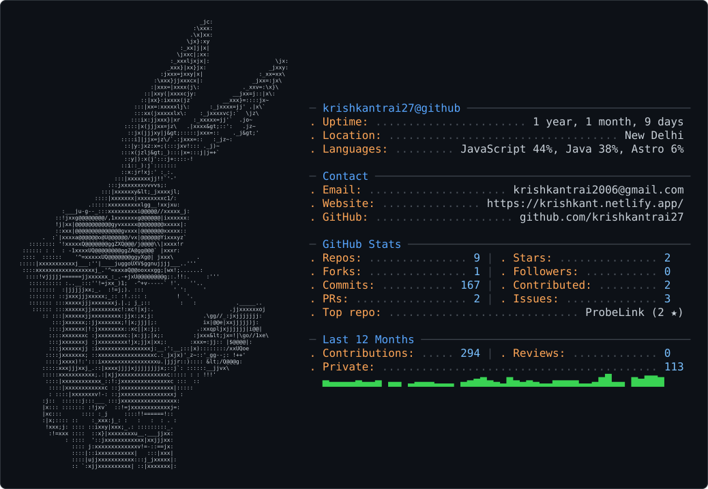

Setup (delete this file before pushing if you want a clean repo)

1. Create a PUBLIC repo named exactly krishkantrai27 (same as your username). Its README shows on your profile.
2. Copy all files from this folder into that repo.
3. Download the crafter cards into the repo root (README already references them):
   curl -fL "https://gh.crafter.run/krishkantrai27?theme=dark" -o dark_mode.svg
   curl -fL "https://gh.crafter.run/krishkantrai27?theme=light" -o light_mode.svg
   If the light card reads poorly on white, replace the <picture> block in README.md with:
   
4. git add . && git commit -m "feat: add animated profile README" && git push origin main
5. Repo -> Settings -> Actions -> General -> Workflow permissions -> "Read and write permissions" -> Save.
6. Repo -> Actions -> "Update profile art" -> Run workflow once. After that it refreshes every hour on its own.

Regenerate locally
   pip install -r scripts/requirements.txt
   python scripts/fetch_contributions.py
   python scripts/render_heatmap_svg.py
   python scripts/render_stats_svg.py
   python scripts/make_intro_svg.py
   python scripts/make_ascii_svg.py source/avatar.png
